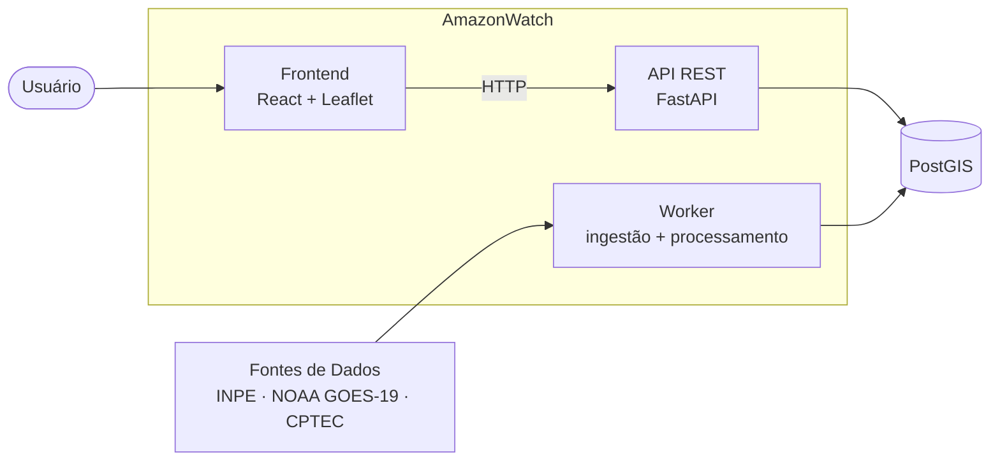

# AmazonWatch 🛰️🔥

Sistema de monitoramento em tempo quase real que correlaciona **nuvens de fumaça** e os **incêndios de onde elas se originaram** na **Amazônia Legal**, utilizando dados do **BDQueimadas/INPE** e **NOAA GOES-19**.

Endrio Agassi Bernardes De Almeida
---

## 🧭 Metodologia e Fontes de Dados

| Camada | Fonte | Produto / Formato | Frequência |
|---|---|---|---|
| **Focos de Incêndio** | INPE / BDQueimadas | CSV de 10 minutos (`lat, lon, satelite, data`) | 10 min |
| **Plumas de Fumaça** | NOAA GOES-19 | S3 público: `ABI-L2-ADPF` (Aerosol Detection Product) | 10 min |
| **Imagem de Fundo** | INPE / CPTEC (DSAT) | Mosaico True Color + IR 10.35 µm reprojetado para WGS-84 | 10 min |
| **Limite Territorial** | IBGE (2022) | Geometria simplificada da Amazônia Legal | Estático |

### Algoritmo de Detecção e Associação Pluma ➔ Foco

1. **Extração de Plumas (NOAA ADP):**
   - Recorta os dados geoestacionários na extensão da Amazônia Legal.
   - Aplica a máscara `Smoke == 1` com filtro de qualidade (bits 2–3 do `DQF`).
   - Aplica fechamento morfológico para unir fragmentos contíguos e elimina ruídos menores que 10 pixels.
   - Poligoniza o raster (`rasterio.features.shapes`) e reprojeta os polígonos para coordenadas geográficas WGS-84 (`EPSG:4326`).
   - Calcula a área geodésica em km² de cada pluma.

2. **Associação e Identificação da Origem:**
   - Para cada pluma em um instante $t$, busca focos detectados na janela temporal $[t - 6\text{h}, t + 10\text{min}]$ dentro ou a até 25 km da borda da pluma (`ST_DWithin` geográfico no PostGIS).
   - Agrupa os focos espacialmente com `ST_ClusterDBSCAN` para consolidar detecções repetidas do mesmo incêndio.
   - Calcula um score por decaimento exponencial de distância e tempo:
     $$\text{Score} = \exp\left(-\frac{d}{D_0}\right) \cdot \exp\left(-\frac{\Delta t}{T_0}\right)$$
   - O grupo de maior densidade e score combinado é classificado como a **origem provável**, criando uma linha vetorial que liga o incêndio ao centro de massa da fumaça.

---

## 🏗️ Arquitetura do Sistema

```
AmazonWatch/
├── docker-compose.yml          # Orquestração (PostGIS, API, Worker, Frontend)
├── .env.example                # Variáveis de ambiente
├── backend/
│   ├── Dockerfile
│   ├── requirements.txt
│   ├── alembic/                # Migrações PostGIS (SRID 4326)
│   ├── app/
│   │   ├── main.py             # Aplicação FastAPI
│   │   ├── config.py           # Configurações Pydantic
│   │   ├── models.py           # Modelos GeoAlchemy2 / SQLAlchemy
│   │   ├── schemas.py          # Schemas Pydantic / GeoJSON
│   │   ├── region.py           # Limite da Amazônia Legal (IBGE)
│   │   ├── worker.py           # Worker agendado (APScheduler)
│   │   ├── api/                # Endpoints REST (/hotspots, /plumes, /frames, /stats, /health)
│   │   ├── ingest/             # bdqueimadas.py, goes_adp.py, dsat_frames.py
│   │   └── processing/         # smoke.py, association.py, geos.py
│   └── tests/                  # Testes unitários pytest
└── frontend/
    ├── Dockerfile
    ├── nginx.conf              # Nginx com proxy para API e entrega direta de mídia
    ├── src/
    │   ├── App.tsx             # Aplicação React
    │   ├── api.ts              # Cliente REST
    │   ├── types.ts            # Tipagens TypeScript
    │   ├── index.css           # Design system escuro (Glassmorphism)
    │   └── components/
    │       ├── MapView.tsx         # Mapa interativo Leaflet
    │       ├── Header.tsx          # Métricas em tempo real e toggles
    │       ├── TimelineDeck.tsx    # Controle temporal com player
    │       ├── PlumeInspector.tsx  # Painel de auditoria da pluma
    │       └── Legend.tsx          # Legenda das camadas
```

### Diagrama de Componentes



> [!NOTE]
> A API e o worker usam a mesma imagem Docker (`backend/`) e compartilham o banco PostGIS e o volume `media_data`. Em produção, o Nginx serve frontend e API na mesma origem.

---

## 🚀 Como Executar

### Opção 1: Via Docker Compose (Recomendado)

Suba toda a infraestrutura com um único comando:

```bash
docker compose up --build
```

O compose inicializará:
- **Frontend:** http://localhost:3000
- **FastAPI / Swagger:** http://localhost:8000/docs
- **PostGIS:** `localhost:5433` (banco `amazonwatch`, usuário `amazonwatch`)
- **Worker:** Executa a ingestão automaticamente a cada 5 minutos.
- **Migrações:** O serviço temporário `migrate` executa `alembic upgrade head` e encerra. API e worker aguardam sua conclusão.

API, worker e migrações usam a imagem `amazonwatch-backend:local`. O código do
backend está incorporado à imagem. Após alterações, execute
`docker compose up -d --build` para reconstruir e atualizar os serviços.
O Nginx entrega `/media/` diretamente do volume `media_data`, montado somente
para leitura no frontend. O worker grava nesse volume, e a API mantém acesso
para inicializar os diretórios e atender o acesso direto pela porta 8000.
Mantenha uma instância do worker, pois ele contém o agendador do pipeline.

---

### Opção 2: Desenvolvimento Local

#### 1. Banco de Dados PostGIS
Suba apenas o PostGIS via Docker:
```bash
docker compose up -d postgis
```

#### 2. Backend (FastAPI + Worker)
```bash
cd backend

# Executar migrações do banco
alembic upgrade head

# Executar testes unitários
python3 -m pytest -v

# Iniciar API
uvicorn app.main:app --reload --port 8000

# Executar o worker de ingestão (em outro terminal)
python3 -m app.worker
```

#### 3. Frontend (Vite + React)
```bash
cd frontend
npm install
npm run dev
```
Acesse em: http://localhost:5173

---

## 📡 Endpoints da API REST

### Recuperação de senha por e-mail

Na tela de login, selecione **Esqueci minha senha**. O link enviado ao e-mail cadastrado
abre o formulário de redefinição e expira em 30 minutos. Depois da troca, entre com a
nova senha. As sessões anteriores são invalidadas.

Para habilitar a entrega, configure `APP_PUBLIC_URL` com o endereço público HTTPS do
frontend e preencha `SMTP_HOST`, `SMTP_PORT`, `SMTP_USER`, `SMTP_PASSWORD` e `SMTP_FROM`
no `.env`. Use um remetente autorizado pelo provedor. A porta 587 usa STARTTLS e a
porta 465 usa TLS desde a conexão. O serviço migrate do Compose aplica as migrações antes de iniciar API e worker.
Em execução local fora do Compose, execute `alembic upgrade head` antes de subir a API.

### Rotas públicas de monitoramento

- `GET /api/plumes` — Lista polígonos de plumas de fumaça no formato GeoJSON.
- `GET /api/plumes/{id}` — Detalhes completos da pluma, centróide e focos de incêndio de origem.
- `GET /api/plumes/timeline` — Horários com scans de satélite disponíveis nas últimas 24h.
- `GET /api/hotspots` — Focos de calor em formato GeoJSON com filtros de data e bounding box.
- `GET /api/frames` — Lista de quadros de imagem de satélite True Color reprojetados.
- `GET /api/stats` — Totais de focos, plumas ativas, área total coberta e incêndios de origem.
- `GET /api/region` — GeoJSON do polígono da Amazônia Legal.
- `GET /api/health` — Status de conectividade e horários dos últimos dados ingeridos.

### Associação com vento IGRA

O worker baixa automaticamente o catálogo de estações e os arquivos recentes IGRA
v2 da NOAA, consultando a fonte a cada 60 minutos. Seleciona estações com atividade
no ano atual ou anterior entre 22°S–10°N e 82°W–40°W. O volume `igra_data` preserva
um snapshot dos perfis recentes entre reinícios. Cada atualização substitui os
perfis por estação, evitando duplicatas, e mantém os anteriores se o download falhar.

A associação escolhe a estação mais próxima com sondagem anterior ao scan, idade
máxima de 24 horas e distância máxima de 500 km. Interpola componentes do vento nos
níveis de 925, 850 e 700 hPa, sem extrapolar níveis ausentes. Calcula seis horas de
advecção retroativa, assumindo vento uniforme e constante em cada nível de pressão.
Esses parâmetros iniciais exigem validação. Níveis de pressão não correspondem a
alturas fixas sobre o solo. O modelo não acompanha movimentos verticais nem a
identidade de uma pluma entre scans.

Os focos compatíveis são procurados a até 25 km do percurso, com tolerância temporal
de uma hora. Sem observação adequada, usa-se a associação espacial anterior e o
motivo aparece nos logs. Os dados usam pressão em Pa e velocidade em décimos de m/s,
convertidas internamente para hPa e m/s. A direção meteorológica é convertida para
componentes leste/norte antes da interpolação.

Execute `docker compose up -d --build` para aplicar. O arquivo adicional do HYSPLIT
foi removido. As variáveis `IGRA_ENABLED` (padrão true) e `IGRA_REFRESH_MINUTES`
(padrão 60) podem ser configuradas no `.env`. O pipeline consulta as demais fontes
cada cinco minutos e o mapa atualiza a cada dois minutos. A disponibilidade de novas
sondagens depende da NOAA e da frequência de observação da estação.

### Retenção dos arquivos coletados

O worker remove imagens de satélite com mais de 48 horas e seus registros de
quadros no banco. Também verifica imagens órfãs em `/data/media/frames` pela data
de modificação. Os arquivos NetCDF baixados ficam em `/data/netcdf`, no volume
`netcdf_data`, por 48 horas após o download. Downloads incompletos são removidos
em caso de erro; resíduos de uma interrupção são eliminados após 48 horas.
A limpeza ocorre antes e depois de cada ciclo do worker (a cada 5 minutos por
padrão), inclusive na inicialização. O worker precisa estar em execução.

As variáveis `FRAME_RETENTION_HOURS=48` e `NETCDF_RETENTION_HOURS=48` controlam
os prazos no `.env`. O histórico de focos e plumas mantém sua retenção própria.
A limpeza também remove arquivos `tmp*.nc` diretamente em `/tmp` com mais de
`NETCDF_RETENTION_HOURS` horas, incluindo resíduos do coletor anterior. Outros
nomes, subdiretórios e links simbólicos são preservados. No Docker, esse caminho
é o `/tmp` do container do worker, não o `/tmp` do servidor host.

Para aplicar uma atualização em uma instalação Docker existente:

```bash
docker compose up -d --build worker
```
